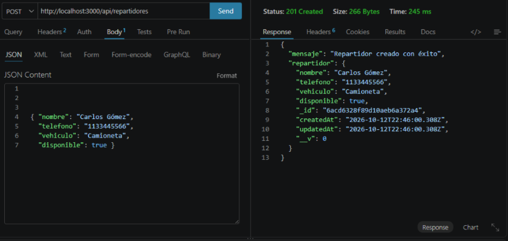
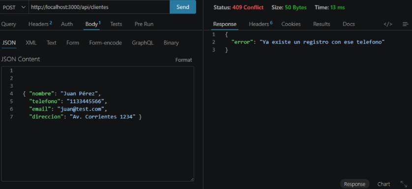
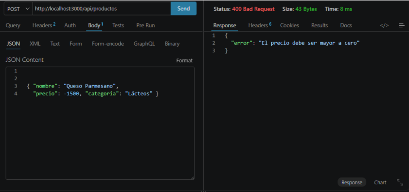
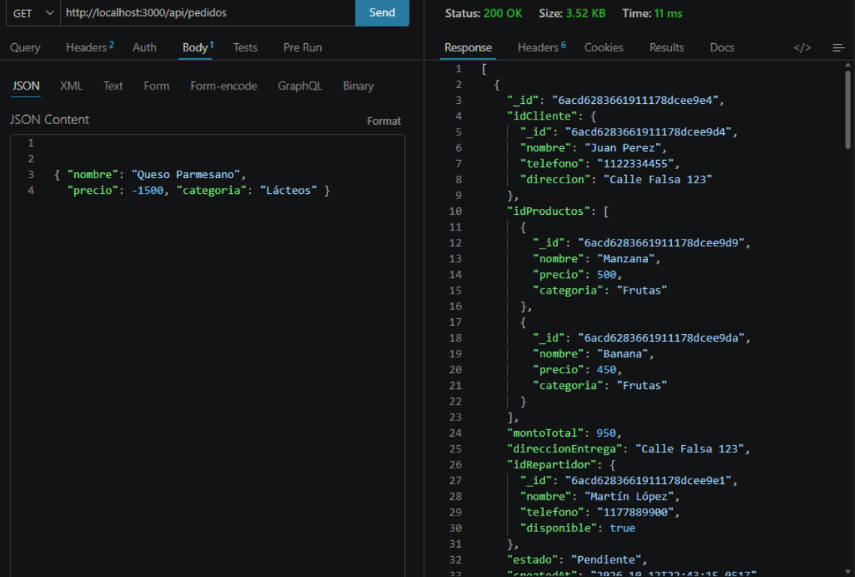

# 🚚 DSWB_2A_FreshRoute_2C26_Grupo_The_Engine

API REST y panel web para la gestión de pedidos de FreshRoute, un sistema de distribución B2B. Permite administrar usuarios operadores, clientes, productos, repartidores y pedidos, con persistencia en **MongoDB Atlas**, autenticación mediante **cookies/sesiones (Passport.js)** y **JSON Web Tokens (JWT)**, y configuración lista para despliegue en **Vercel**.


---

## 🛠 Stack tecnológico

- **Node.js + Express 5** (arquitectura MVC modular + middlewares)
- **MongoDB Atlas + Mongoose** (persistencia de datos en la nube con esquemas validados y relaciones `ObjectId`)
- **Autenticación y Seguridad:**
  - `bcrypt` para encriptación irreversible de contraseñas (`saltRounds = 10`)
  - `cookie-parser` y `express-session` para administración de cookies (`httpOnly`) y sesiones de usuario
  - `passport`, `passport-local` y `connect-flash` para estrategias de inicio de sesión (`login`), registro (`signup`) y protección de rutas del panel web
  - `jsonwebtoken` (JWT) para autenticación stateless mediante token `Bearer` en la API REST
- **Pug** (motor de plantillas para las vistas `/login`, `/signup` y el panel de gestión `/`)
- **Jest + Supertest + mongodb-memory-server** (suite de 51 pruebas automatizadas de integración)
- **Vercel** (`vercel.json` configurado con `@vercel/node` para despliegue en producción)

## 📦 Instalación y configuración

Instalar las dependencias:

```bash
npm install
```

Crear un archivo `.env` a partir de `.env.example`:

```bash
cp .env.example .env
```

En Windows PowerShell:

```powershell
Copy-Item .env.example .env
```

### Variables de entorno (`.env`)

| Variable | Descripción | Valor por defecto / Ejemplo |
|---|---|---|
| `PORT` | Puerto del servidor | `3000` |
| `HOST` | Interfaz de escucha | `127.0.0.1` |
| `MONGO_URI` | URI de conexión a MongoDB Atlas (o local) | `mongodb+srv://<usuario>:<password>@cluster.mongodb.net/freshroute?retryWrites=true&w=majority` |
| `SECRET` | Clave secreta para firmar sesiones y tokens JWT | `freshroute_the_engine_secret_key_2026` |

> **Nota de seguridad:** El archivo `.env` no se versiona porque está incluido en `.gitignore`. En Vercel, las variables `MONGO_URI` y `SECRET` se configuran en *Settings → Environment Variables*.

### Carga de datos iniciales (Seed)

Para poblar la base de datos en MongoDB Atlas con usuarios operadores, clientes, productos, repartidores y pedidos de prueba:

```bash
npm run seed
```

**Usuarios operadores creados por `npm run seed`:**

| Usuario (`username`) | Contraseña (`password`) | Nombre |
|---|---|---|
| `admin` | `admin1234` | Administrador FreshRoute |
| `theengine` | `engine2026` | Operador The Engine |

También se puede registrar cualquier nuevo usuario directamente desde la vista web `/signup` o mediante `POST /api/usuarios`.

## 🚀 Uso

Levantar el servidor en modo desarrollo:

```bash
npm run dev
```

Levantar el servidor en modo producción:

```bash
npm start
```

- **Login del panel web:** `http://localhost:3000/login`
- **Registro de usuario:** `http://localhost:3000/signup`
- **Panel web (protegido por sesión):** `http://localhost:3000/`
- **API REST:** `http://localhost:3000/api/...`

## 🧪 Tests

Ejecutar las pruebas automatizadas:

```bash
npm test
```

La suite cuenta con **51 tests distribuidos en 6 suites** (`auth`, `clientes`, `productos`, `repartidores`, `pedidos` y `panel`), utilizando Jest y Supertest contra una base de datos MongoDB en memoria (`mongodb-memory-server`), sin afectar los datos reales de MongoDB Atlas.

## 🗂 Estructura del proyecto

```text
index.js          # Punto de entrada local y exportación compatible con Vercel
app.js            # Aplicación Express: cookies, sesiones, Passport, rutas y errores
vercel.json       # Configuración de despliegue serverless para Vercel (@vercel/node)
seed.js           # Script de carga inicial de datos y usuarios en MongoDB Atlas
config/           # Configuración de conexión a MongoDB Atlas (config/db.js)
passport/         # Estrategias Passport Local (init.js, login.js, signup.js)
models/           # Schemas Mongoose (Usuario, Cliente, Producto, Repartidor, Pedido)
controllers/      # Controladores de autenticación, API REST y vistas Pug
routes/           # Definición de rutas (auth, clientes, productos, repartidores, pedidos, vistas)
middlewares/      # Autenticación (isAuthenticated, verificarToken), errores y 404
views/            # Plantillas Pug (login.pug, register.pug, index.pug)
tests/            # Pruebas automatizadas con Jest y Supertest (6 suites, 51 tests)
docs/             # Requerimientos, modelo de datos, plan de pruebas y evidencias
```

---

## 🔐 Autenticación, Cookies y Sesiones

El proyecto implementa los dos esquemas de autenticación estudiados en la cátedra:

1. **Autenticación basada en Sesiones y Cookies (Panel Web Pug):**
   - Configurada con `cookie-parser`, `express-session` (`httpOnly: true`), `passport`, `passport-local` y `connect-flash`.
   - Al iniciar sesión en `POST /login`, Passport serializa el `id` del usuario en la sesión (`connect.sid`) y el servidor envía además la cookie `ultimoAcceso` (`httpOnly`) para mostrar la fecha y hora de ingreso en el encabezado del panel.
   - Todas las rutas del panel (`/`, `/agregar-*`, `/eliminar-*`) están protegidas por el middleware `isAuthenticated`. Si no existe sesión activa, redirige automáticamente a `/login`.
   - La ruta `GET /signout` invoca `req.logout()`, destruye la sesión con `req.session.destroy()`, limpia la cookie `ultimoAcceso` con `res.clearCookie()` y redirige a `/login`.

2. **Autenticación basada en Token JWT (API REST):**
   - `POST /api/usuarios`: Registra un nuevo usuario hasheando su contraseña con `bcrypt.hash(password, 10)`. El modelo oculta `passwordHash` en todas las respuestas JSON.
   - `POST /api/login`: Verifica credenciales con `bcrypt.compare()` y firma un token con `jwt.sign({ username, id }, process.env.SECRET, { expiresIn: '1h' })`.
   - `GET /api/perfil`: Ruta protegida por el middleware `verificarToken`, que extrae el encabezado `Authorization: Bearer <token>` y valida la firma con `jwt.verify()`.

### Rutas de Autenticación

| Método | Ruta | Tipo | Descripción |
|---|---|---|---|
| GET | `/login` | Web (Pug) | Formulario de inicio de sesión. |
| POST | `/login` | Web (Passport) | Autentica con estrategia local, crea sesión y setea cookie `ultimoAcceso`. |
| GET | `/signup` | Web (Pug) | Formulario de registro de nuevo operador. |
| POST | `/signup` | Web (Passport) | Registra usuario con contraseña encriptada (`bcrypt`) e inicia sesión. |
| GET | `/signout` | Web (Passport) | Cierra la sesión, elimina cookies y redirige a `/login`. |
| POST | `/api/usuarios` | API REST | Crea un usuario con contraseña encriptada (`201 Created`). |
| GET | `/api/usuarios` | API REST | Lista los usuarios registrados (sin exponer `passwordHash`). |
| POST | `/api/login` | API REST | Autentica usuario y devuelve `{ token, username, name }` (`200 OK`). |
| GET | `/api/perfil` | API REST | Devuelve los datos del usuario autenticado (requiere `Bearer <token>` o sesión). |

---

## 📡 Endpoints de la API REST de Negocio

### Clientes — `/api/clientes`

| Método | Ruta | Descripción |
|---|---|---|
| GET | `/api/clientes` | Lista todos los clientes. Admite `?nombre=` para filtrar por nombre parcial. |
| GET | `/api/clientes/:id` | Devuelve un cliente por ID. |
| POST | `/api/clientes` | Crea un cliente. |
| PUT | `/api/clientes/:id` | Actualiza los datos de un cliente. |
| DELETE | `/api/clientes/:id` | Elimina un cliente. No está permitido si tiene pedidos activos. |

### Productos — `/api/productos`

| Método | Ruta | Descripción |
|---|---|---|
| GET | `/api/productos` | Lista todos los productos. Admite `?nombre=` y `?categoria=` para filtrar. |
| GET | `/api/productos/:id` | Devuelve un producto por ID. |
| POST | `/api/productos` | Crea un producto. |
| PUT | `/api/productos/:id` | Actualiza los datos de un producto. |
| PUT/PATCH | `/api/productos/:id/stock` | Ajusta el stock según el valor de `cantidad`. |
| DELETE | `/api/productos/:id` | Elimina un producto. No está permitido si tiene pedidos activos. |

### Repartidores — `/api/repartidores`

| Método | Ruta | Descripción |
|---|---|---|
| GET | `/api/repartidores` | Lista los repartidores. |
| GET | `/api/repartidores/:id` | Devuelve un repartidor por ID. |
| POST | `/api/repartidores` | Crea un repartidor. |
| PUT | `/api/repartidores/:id` | Actualiza un repartidor, incluida su disponibilidad. |
| DELETE | `/api/repartidores/:id` | Elimina un repartidor. |

### Pedidos — `/api/pedidos`

| Método | Ruta | Descripción |
|---|---|---|
| GET | `/api/pedidos` | Lista todos los pedidos con sus relaciones resueltas (`populate`): cliente, productos y repartidor. Admite `?estado=` y `?idCliente=` para filtrar. |
| GET | `/api/pedidos/:id` | Devuelve un pedido por ID. |
| POST | `/api/pedidos` | Crea un pedido calculando `montoTotal` automáticamente. |
| PUT/PATCH | `/api/pedidos/:id/estado` | Cambia el estado de un pedido respetando las reglas de transición. |

---

## 🗃️ Esquemas de datos

Todos los documentos tienen `_id` (ObjectId generado por MongoDB), `createdAt` y `updatedAt`.

### Usuario

| Campo | Tipo | Descripción |
|---|---|---|
| `username` | string | Obligatorio, único y en minúsculas. |
| `name` | string | Nombre visible del operador. |
| `passwordHash` | string | Contraseña encriptada con `bcrypt` (oculta en `toJSON`). |

### Cliente

| Campo | Tipo | Descripción |
|---|---|---|
| `nombre` | string | Obligatorio. |
| `telefono` | string | Obligatorio y único. |
| `direccion` | string | Obligatorio. |

### Producto

| Campo | Tipo | Descripción |
|---|---|---|
| `nombre` | string | Obligatorio y único, sin distinguir mayúsculas y minúsculas. |
| `precio` | number | Obligatorio y mayor a 0. |
| `stock` | number | Obligatorio y no negativo. |
| `categoria` | string | Opcional. |

### Repartidor

| Campo | Tipo | Descripción |
|---|---|---|
| `nombre` | string | Obligatorio. |
| `telefono` | string | Obligatorio. |
| `vehiculo` | string | Obligatorio. |
| `disponible` | boolean | `true` por defecto. |

### Pedido

| Campo | Tipo | Descripción |
|---|---|---|
| `idCliente` | ObjectId (Cliente) | Obligatorio; debe existir. |
| `idProductos` | ObjectId[] (Producto) | Obligatorio; debe contener al menos un producto existente. |
| `idRepartidor` | ObjectId (Repartidor) o `null` | Opcional; debe existir si se indica. |
| `montoTotal` | number | Calculado al crear el pedido. |
| `direccionEntrega` | string | Por defecto, utiliza la dirección del cliente. |
| `estado` | string | `Pendiente` por defecto (`Pendiente`, `Preparado`, `En camino`, `Entregado`, `Cancelado`). |

---

## ⚠️ Respuestas de error

Las validaciones y reglas de negocio se gestionan mediante un middleware centralizado de errores (`middlewares/errorHandler.js`), que devuelve un JSON con la forma:

```json
{
  "error": "mensaje"
}
```

| Código HTTP | Cuándo ocurre |
|---|---|
| `400 Bad Request` | Datos inválidos, errores de validación del schema o de tipos, ID con formato incorrecto, JSON malformado, transición de estado inválida o stock insuficiente. |
| `401 Unauthorized` | Credenciales inválidas en `/api/login`, o token JWT faltante, inválido o expirado. |
| `404 Not Found` | Recurso inexistente, cliente, producto o repartidor referenciado que no existe, o ruta no encontrada. |
| `409 Conflict` | Valor duplicado (`username`, teléfono de cliente o nombre de producto) o conflicto con una regla de negocio (eliminar cliente o producto con pedidos activos). |
| `500 Internal Server Error` | Error inesperado del servidor. |

---

## 📸 Evidencias de pruebas de la API REST

Se realizaron pruebas mediante Thunder Client para verificar el funcionamiento de los endpoints REST, la validación de datos, el cumplimiento de las reglas de negocio y la resolución de relaciones entre documentos.

### A) Alta exitosa de Repartidor vía API REST (201 Created)



### B) Control de datos duplicados en la API REST (409 Conflict)



### C) Validación de datos de entrada y reglas de negocio (400 Bad Request)



### D) Obtención de pedidos con resolución de relaciones (200 OK)



---

# 👥 Roles del Equipo y Bibliografía — FreshRoute B2B

## 1. Integrantes, roles y responsabilidades

| # | Integrante | Rol | Responsabilidades |
|---|---|---|---|
| 1 | Valeria Fernandez | QA Tester & Documentación | Responsable del control de calidad, redacción del informe técnico final, seguimiento de entregables y verificación de requerimientos funcionales del caso FreshRoute. |
| 2 | Micaela Gargiulo | Especialista en Vistas (Pug) | Desarrolladora del panel web de administración y vistas de autenticación utilizando el motor de plantillas Pug. Diseño de maquetación, formularios interactivos y tablas dinámicas sincronizadas con el backend. |
| 3 | Carlos Marcelo Hernandez | Desarrollador Backend & Git Manager | Configuración de la estructura MVC, autenticación con Passport/JWT, migración a MongoDB Atlas, preparación para despliegue en Vercel y administración del repositorio en GitHub. |
| 4 | Javier Lopez | Arquitecto de Software | Diseño de esquemas de datos en Mongoose, relaciones entre colecciones mediante `ObjectId`, reglas de negocio del dominio, middleware centralizado de manejo de errores y suite de pruebas automatizadas con Jest y Supertest. |
| 5 | Dámaris Rodriguez | Persistencia, API REST & Testing | Implementación y auditoría de endpoints RESTful en Express, conexión con MongoDB mediante variables de entorno, pruebas de la API en Thunder Client y elaboración del plan de evidencia. |

---

### Documentación adicional

- **Apuntes y material teórico de la cátedra:** Desarrollo de Sistemas Web (Backend) del IFTS N.º 29 (D8: Bases de datos en Express, D10: Autenticación, cookies y sesiones, D13: Despliegue de una aplicación con Node.js).
- **Documentación oficial de Node.js y Express.js:** ejecución asíncrona mediante `async/await`, enrutamiento modular con `express.Router` y middlewares.
- **Documentación oficial de MongoDB Atlas y Mongoose:** configuración de clúster en la nube, esquemas, referencias mediante `ObjectId` y resolución de relaciones con `populate`.
- **Documentación de Passport.js y JSON Web Tokens (JWT):** estrategias de autenticación local con sesiones/cookies y tokens firmados.
