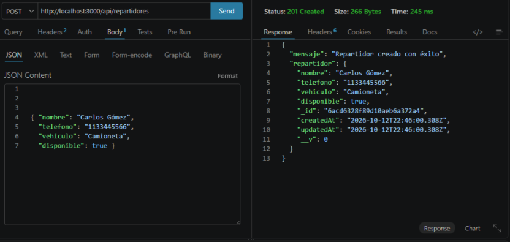
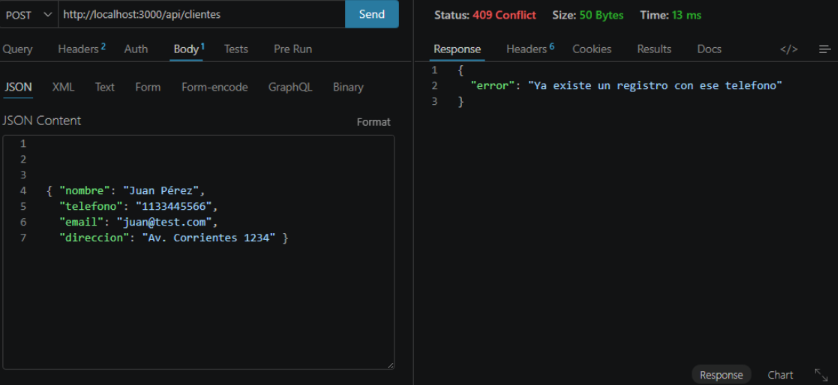
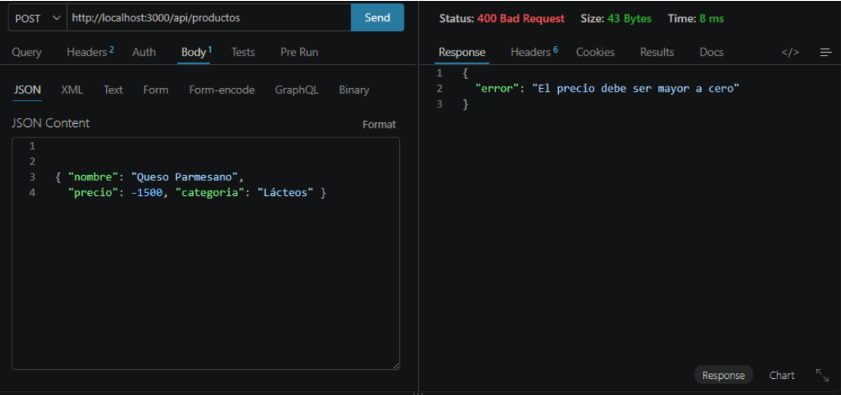
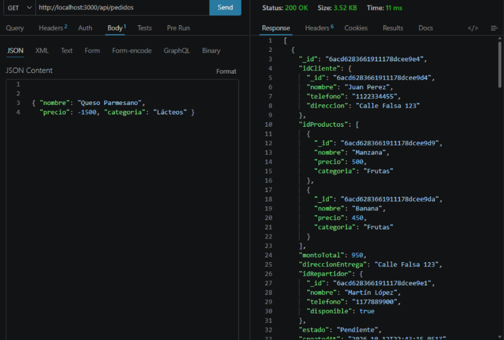

# 🚚 DSWB_2A_FreshRoute_2C26_Grupo_The_Engine

API REST y panel web para la gestión de pedidos de FreshRoute, un sistema de distribución. Permite administrar clientes, productos, repartidores y pedidos.


---

## 🛠 Stack tecnológico

- Node.js + Express 5
- MongoDB + Mongoose (persistencia)
- Pug (panel visual en `/` para registrar y consultar los datos)
- Jest + Supertest + mongodb-memory-server para los tests

## 📦 Instalación

Instalar las dependencias:

```bash
npm install
```

Crear un archivo `.env` a partir del ejemplo y ajustar la URI de MongoDB si hace falta:

```bash
cp .env.example .env
```

En Windows PowerShell también se puede utilizar:

```powershell
Copy-Item .env.example .env
```

### Variables de entorno

| Variable | Descripción | Valor por defecto |
|---|---|---|
| `PORT` | Puerto del servidor | `3000` |
| `HOST` | Interfaz de escucha | `127.0.0.1` |
| `MONGO_URI` | URI de conexión a MongoDB | `mongodb://localhost:27017/freshroute` |

El archivo `.env` no se versiona porque está incluido en `.gitignore`. Se necesita una instancia de MongoDB en funcionamiento, local o en MongoDB Atlas.

## 🚀 Uso

Levantar el servidor en modo desarrollo:

```bash
npm run dev
```

Levantar el servidor sin recarga automática:

```bash
node index.js
```

Por defecto, el servidor utiliza el puerto `3000` y escucha en `127.0.0.1`, salvo que se configure otro valor en el archivo `.env`.

- Panel web: `http://localhost:3000/`
- API REST: `http://localhost:3000/api/...`

## 🧪 Tests

Ejecutar las pruebas automatizadas:

```bash
npm test
```

Los tests cubren los módulos de clientes, productos, repartidores, pedidos y panel web, utilizando Jest y Supertest contra la aplicación Express y una base de datos MongoDB en memoria mediante `mongodb-memory-server`.

No es necesario tener una instancia de MongoDB instalada ni se modifica la base de datos real durante estas pruebas. La primera ejecución puede descargar el binario de MongoDB si todavía no está disponible localmente.

El script utiliza `--experimental-vm-modules` porque el driver de MongoDB necesita este modo para funcionar dentro de Jest en la configuración del proyecto.

## 🗂 Estructura del proyecto

```text
index.js          # Punto de entrada: conecta a MongoDB y levanta el servidor
app.js            # Aplicación Express: middlewares, rutas y errores
config/           # Configuración de la conexión a MongoDB
models/           # Schemas de Mongoose, reglas de negocio y clases de error
controllers/      # Lógica de los endpoints y del panel web
routes/           # Definición de rutas de Express para API y panel
middlewares/      # Manejo centralizado de errores y respuestas 404
views/            # Plantillas Pug del panel web
tests/            # Pruebas automatizadas con Jest y Supertest
docs/             # Requerimientos, modelo de datos, plan de pruebas y evidencias
```

---

## 📡 Endpoints de la API REST

### Clientes — `/api/clientes`

| Método | Ruta | Descripción |
|---|---|---|
| GET | `/api/clientes` | Lista todos los clientes. Admite `?nombre=` para filtrar por nombre parcial. |
| GET | `/api/clientes/:id` | Devuelve un cliente por ID. |
| POST | `/api/clientes` | Crea un cliente. |
| PUT | `/api/clientes/:id` | Actualiza los datos de un cliente. |
| DELETE | `/api/clientes/:id` | Elimina un cliente. No está permitido si tiene pedidos activos. |

**Body para crear o actualizar un cliente**

Al crear un cliente, `nombre`, `telefono` y `direccion` son obligatorios.

```json
{
  "nombre": "Juan Perez",
  "telefono": "1122334455",
  "direccion": "Calle Falsa 123"
}
```

### Productos — `/api/productos`

| Método | Ruta | Descripción |
|---|---|---|
| GET | `/api/productos` | Lista todos los productos. Admite `?nombre=` y `?categoria=` para filtrar. |
| GET | `/api/productos/:id` | Devuelve un producto por ID. |
| POST | `/api/productos` | Crea un producto. |
| PUT | `/api/productos/:id` | Actualiza los datos de un producto. |
| PUT/PATCH | `/api/productos/:id/stock` | Ajusta el stock según el valor de `cantidad`. |
| DELETE | `/api/productos/:id` | Elimina un producto. No está permitido si tiene pedidos activos. |

**Body para crear o actualizar un producto**

Al crear un producto, `nombre`, `precio` y `stock` son obligatorios.

```json
{
  "nombre": "Manzana",
  "precio": 500,
  "stock": 100,
  "categoria": "Frutas"
}
```

**Body para ajustar el stock**

La propiedad `cantidad` puede ser negativa para descontar unidades.

```json
{
  "cantidad": -20
}
```

### Repartidores — `/api/repartidores`

| Método | Ruta | Descripción |
|---|---|---|
| GET | `/api/repartidores` | Lista los repartidores. |
| GET | `/api/repartidores/:id` | Devuelve un repartidor por ID. |
| POST | `/api/repartidores` | Crea un repartidor. |
| PUT | `/api/repartidores/:id` | Actualiza un repartidor, incluida su disponibilidad. |
| DELETE | `/api/repartidores/:id` | Elimina un repartidor. |

**Body para crear un repartidor**

Los campos `nombre`, `telefono` y `vehiculo` son obligatorios.

```json
{
  "nombre": "Carlos",
  "telefono": "1133445566",
  "vehiculo": "Moto"
}
```

### Pedidos — `/api/pedidos`

| Método | Ruta | Descripción |
|---|---|---|
| GET | `/api/pedidos` | Lista todos los pedidos con sus relaciones resueltas: cliente, productos y repartidor. Admite `?estado=` y `?idCliente=` para filtrar. |
| GET | `/api/pedidos/:id` | Devuelve un pedido por ID. |
| POST | `/api/pedidos` | Crea un pedido. El cliente y los productos deben existir; el repartidor debe existir si se indica. |
| PUT/PATCH | `/api/pedidos/:id/estado` | Cambia el estado de un pedido. |

**Body para crear un pedido**

Los campos `idCliente` e `idProductos` son obligatorios. `idRepartidor` y `direccionEntrega` son opcionales.

```json
{
  "idCliente": "64b7f0c2a1b2c3d4e5f60718",
  "idProductos": [
    "64b7f0c2a1b2c3d4e5f60719"
  ],
  "idRepartidor": null,
  "direccionEntrega": "Av. Siempre Viva 742"
}
```

El campo `montoTotal` se calcula sumando los precios de los productos incluidos en el pedido. Si no se indica `direccionEntrega`, se utiliza la dirección registrada del cliente.

**Body para cambiar el estado de un pedido**

```json
{
  "nuevoEstado": "Preparado"
}
```

**Estados y reglas de negocio**

Los estados contemplados son:

`Pendiente` → `Preparado` → `En camino` → `Entregado`

También se contempla el estado `Cancelado`.

- Un pedido `Entregado` no puede volver a `Pendiente`.
- Un pedido `Cancelado` no puede pasar a `En camino`.
- Se consideran pedidos activos aquellos que están en `Pendiente`, `Preparado` o `En camino`.

---

## 🗃️ Esquemas de datos

Todos los documentos tienen `_id` (ObjectId generado por MongoDB), `createdAt` y `updatedAt`.

### Cliente

| Campo | Tipo | Descripción |
|---|---|---|
| `nombre` | string | Obligatorio. |
| `telefono` | string | Obligatorio y único. |
| `direccion` | string | Obligatorio. |

### Producto

| Campo | Tipo | Descripción |
|---|---|---|
| `nombre` | string | Obligatorio y único, sin distinguir mayúsculas y minúsculas. |
| `precio` | number | Obligatorio y mayor a 0. |
| `stock` | number | Obligatorio y no negativo. |
| `categoria` | string | Opcional. |

### Repartidor

| Campo | Tipo | Descripción |
|---|---|---|
| `nombre` | string | Obligatorio. |
| `telefono` | string | Obligatorio. |
| `vehiculo` | string | Obligatorio. |
| `disponible` | boolean | `true` por defecto. |

### Pedido

| Campo | Tipo | Descripción |
|---|---|---|
| `idCliente` | ObjectId (Cliente) | Obligatorio; debe existir. |
| `idProductos` | ObjectId[] (Producto) | Obligatorio; debe contener al menos un producto existente. |
| `idRepartidor` | ObjectId (Repartidor) o `null` | Opcional; debe existir si se indica. |
| `montoTotal` | number | Calculado al crear el pedido. |
| `direccionEntrega` | string | Por defecto, utiliza la dirección del cliente. |
| `estado` | string | `Pendiente` por defecto. |

---

## ⚠️ Respuestas de error

Las validaciones y reglas de negocio se gestionan mediante un middleware centralizado de errores (`middlewares/errorHandler.js`), que devuelve un JSON con la forma:

```json
{
  "error": "mensaje"
}
```

| Código HTTP | Cuándo ocurre |
|---|---|
| `400 Bad Request` | Datos inválidos, errores de validación del schema o de tipos, ID con formato incorrecto, JSON malformado, transición de estado inválida o stock insuficiente. |
| `404 Not Found` | Recurso inexistente, cliente, producto o repartidor referenciado que no existe, o ruta no encontrada. |
| `409 Conflict` | Valor duplicado, como teléfono de cliente o nombre de producto, o conflicto con una regla de negocio, como eliminar un cliente o producto con pedidos activos. |
| `500 Internal Server Error` | Error inesperado del servidor. |

---

## 📸 Evidencias de pruebas de la API REST

Se realizaron pruebas mediante Thunder Client para verificar el funcionamiento de los endpoints REST, la validación de datos, el cumplimiento de las reglas de negocio y la resolución de relaciones entre documentos.

### A) Alta exitosa de Repartidor vía API REST (201 Created)



### B) Control de datos duplicados en la API REST (409 Conflict)



### C) Validación de datos de entrada y reglas de negocio (400 Bad Request)



### D) Obtención de pedidos con resolución de relaciones (200 OK)



---

## 📚 Documentación adicional

- [Requerimientos funcionales y no funcionales](docs/requerimientos.md)
- [Modelo de datos y flujo de estados](docs/modelo-de-datos.md)
- [Plan de pruebas](docs/plan-de-pruebas.md)

---

# 👥 Roles del Equipo y Bibliografía — FreshRoute B2B

## 1. Integrantes, roles y responsabilidades

| # | Integrante | Rol | Responsabilidades |
|---|---|---|---|
| 1 | Valeria Fernandez | QA Tester & Documentación | Responsable del control de calidad, redacción del informe técnico final, seguimiento de entregables y verificación de requerimientos funcionales del caso FreshRoute. |
| 2 | Micaela Gargiulo | Especialista en Vistas (Pug) | Desarrolladora del panel web de administración utilizando el motor de plantillas Pug. Diseño de maquetación, formularios interactivos y tablas dinámicas sincronizadas con el backend. |
| 3 | Carlos Marcelo Hernandez | Desarrollador Backend & Git Manager | Configuración de la estructura MVC, lógica de controladores, flujo de enrutamiento y administración del repositorio colaborativo en GitHub mediante control de versiones y flujo de ramas. |
| 4 | Javier Lopez | Arquitecto de Software | Diseño de esquemas de datos en Mongoose, relaciones entre colecciones mediante `ObjectId`, reglas de negocio del dominio, middleware centralizado de manejo de errores y suite de pruebas automatizadas con Jest y Supertest. |
| 5 | Dámaris Rodriguez | Persistencia, API REST & Testing | Implementación y auditoría de endpoints RESTful en Express, conexión con MongoDB mediante variables de entorno, pruebas de la API en Thunder Client y elaboración del plan de evidencia. |

---

### Documentación adicional

- **Apuntes y material teórico de la cátedra:** Desarrollo de Sistemas Web (Backend) del IFTS N.º 29, con contenidos sobre Node.js, JavaScript, Express, motores de plantillas y bases de datos NoSQL con Mongoose.
- **Documentación oficial de Node.js:** referencia sobre ejecución asíncrona mediante `async/await`, gestión de eventos y entorno de servidor.
- **Documentación oficial de Express.js:** guías sobre enrutamiento modular mediante `express.Router`, middlewares y gestión de peticiones y respuestas HTTP.
- **Documentación oficial de MongoDB y Mongoose:** referencia sobre modelado de esquemas, conexión asíncrona a la base de datos, referencias mediante `ObjectId` y resolución de relaciones con `populate`.
- **Documentación oficial de Pug:** sintaxis del motor de plantillas para la renderización dinámica de vistas HTML desde el servidor.
- **Documentación de Thunder Client:** guías para probar peticiones HTTP mediante los métodos GET, POST, PUT, PATCH y DELETE, y verificar códigos de estado como `200 OK`, `201 Created`, `400 Bad Request` y `404 Not Found`.