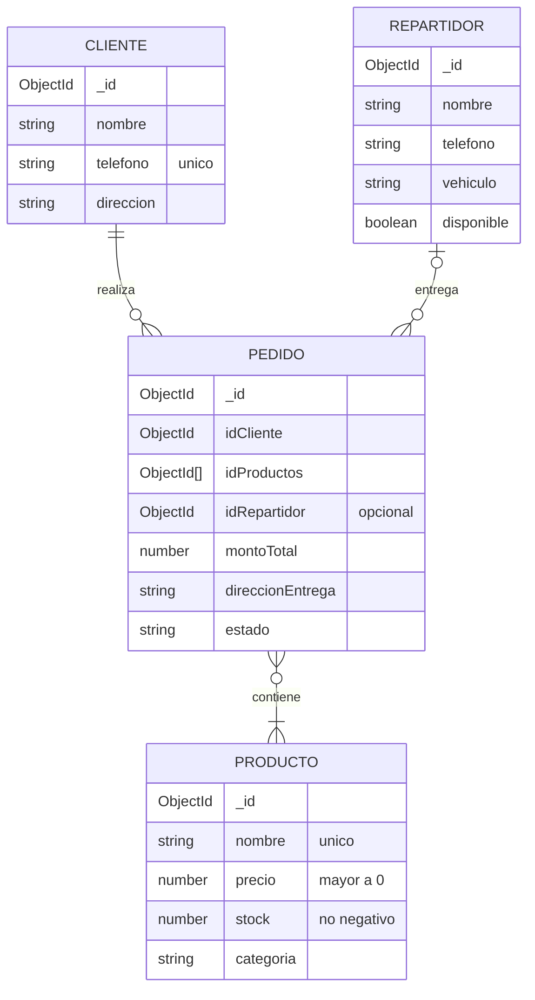
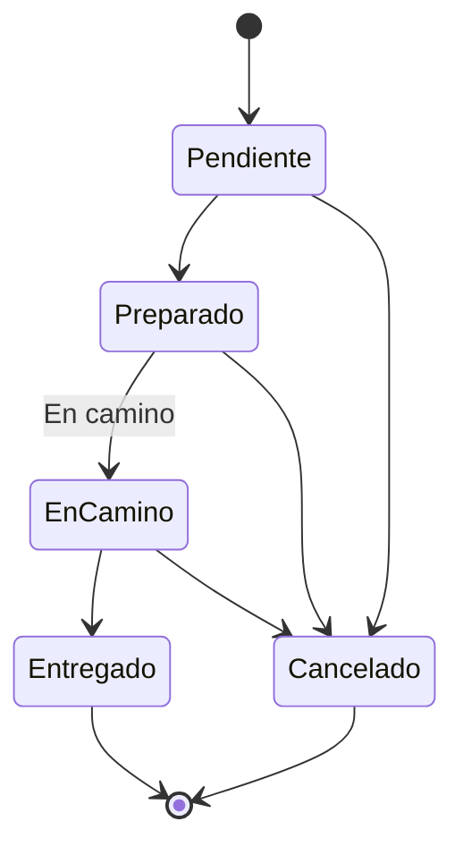

# Modelo de datos y flujo de estados

## Colecciones de MongoDB

Todas las colecciones incluyen `createdAt` y `updatedAt` (opción `timestamps` de Mongoose).

## Estados de un pedido

Reglas implementadas en `Pedido.actualizarEstado`:

- Solo se aceptan los cinco estados definidos.
- Un pedido `Entregado` no puede volver a `Pendiente`.
- Un pedido `Cancelado` no puede pasar a `En camino`.

Se consideran **pedidos activos** los que están en `Pendiente`, `Preparado` o `En camino`; mientras existan, no se puede eliminar el cliente ni los productos involucrados.
